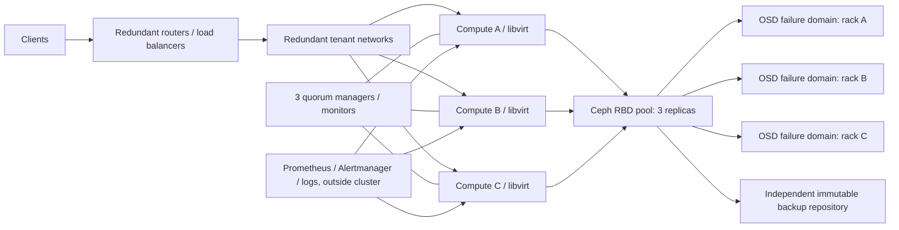

# Proposed HA architecture for 300 VMs

This is a production design, not a claim that the supplied single VM is highly available. The supplied VM has one virtual disk and no independent failure domain. The current [three-guest Ceph laboratory](ceph-lab.md) exercises quorum, replication, and one guest-failure sample within that VM. An earlier [Gluster failover laboratory](kvm-ha-lab.md) was measured and retired.

## Decisions and targets

| Area | Design and reason |
| --- | --- |
| Compute | At least three KVM/libvirt hosts, with spare capacity to absorb one host loss. Keep critical VM replicas in separate hosts and racks. |
| Storage | Ceph RBD with three replicas and rack level CRUSH failure domains. A write is acknowledged only after the replication policy is satisfied. Separate storage traffic from tenant and management traffic on redundant 25 GbE links. |
| Quorum | Three Ceph MONs and an odd number of control-plane votes in separate failure domains. Fence an isolated compute node before starting its guests elsewhere; never run two writers for one disk. |
| Recovery objective | Target RPO 0 for acknowledged writes on a single host or disk failure, subject to healthy quorum and replica policy. Target RTO 15 minutes for automatic restart of eligible VMs after fencing, then validate per workload. These are design targets, not measured results. |
| Backup | Encrypted, versioned, immutable backups in another fault domain with application-consistent snapshots where needed. Daily backup alone may give up to 24 hours RPO; define per workload and test restores monthly. Replication is not backup because deletion, corruption, and ransomware also replicate. |
| Capacity | Measure each VM's p95 CPU/RAM/IOPS and growth. Reserve N+1 compute; keep Ceph below 70% raw use during normal operation to allow recovery, and budget three raw bytes per logical byte before overhead. Do not size 300 VMs from their count alone. |
| Maintenance | Drain/migrate VMs, confirm clean Ceph and spare capacity, patch one host or rack at a time, then verify placement and latency before proceeding. Test fencing and failover on a schedule. |

## Failure behavior

One failed disk or OSD should be replaced and rebalanced while the VMs remain available. One failed compute host requires successful fencing before its VMs restart elsewhere. A lost rack requires enough surviving replicas and compute headroom; test this in staging before promising it. Loss of quorum blocks writes or failover by design, to prevent split brain. Correlated firmware or storage-network faults can breach both objectives, so independent backups and an off-cluster monitoring path remain required.
